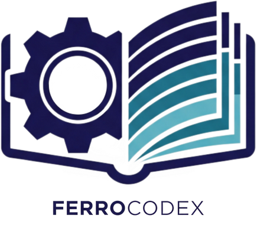

# Ferrocodex

<div align="center">



**Secure, offline-first configuration management for operational technology**

[](https://github.com/HillviewCap/ferrocodex/releases)
[](LICENSE)
[](https://github.com/HillviewCap/ferrocodex/actions/workflows/test.yml)
[](https://ferrocodex.readthedocs.io/en/latest/?badge=latest)

</div>

## Overview

Ferrocodex is a cross-platform desktop application for managing configuration files, firmware, and credentials for industrial equipment. It is built for operational technology (OT) environments where systems are often air-gapped: all data is stored locally, and no network connection is required.

The application is built with Tauri 2.0, with a Rust backend and a React frontend. Native builds are available for Windows, macOS, and Linux.

## Features

- **Offline-first**: Fully functional without network access. Data is stored in a local SQLite database.
- **Configuration versioning**: Branching, version history, and a promotion workflow from working versions to approved ("golden") configurations.
- **Asset hierarchy**: Tree-based organisation of equipment with drag-and-drop, virtualised rendering for large datasets, and bulk import, export, and rename.
- **Search**: Filter the asset tree by name, description, and type, and search vault credentials by name or description.
- **Metadata schemas**: Dynamic, JSON Schema-validated metadata with field templates.
- **Firmware management**: Firmware files stored alongside their configurations, with analysis and integrity checks.
- **Identity vault**: Encrypted storage for equipment credentials, with password rotation, history, and per-user access permissions.
- **Encryption at rest**: Configuration content, firmware files, and vault secrets are encrypted with AES-256-GCM.
- **Access control**: Administrator and Engineer roles, session management, and login rate limiting.
- **Audit trail**: Every configuration change and data access is recorded.
- **Recovery packages**: Export and import bundles for restoring equipment.

See the [documentation](https://ferrocodex.readthedocs.io/en/latest/) for user and administrator guides, and the [releases page](https://github.com/HillviewCap/ferrocodex/releases) for the changelog.

## Installation

### Pre-built binaries

Download the installer for your platform from the [releases page](https://github.com/HillviewCap/ferrocodex/releases). Windows (`.msi`, `.exe`), macOS (`.dmg`, Apple Silicon and Intel), and Linux (`.AppImage`, `.deb`, `.rpm`) builds are provided for each release.

### Building from source

Prerequisites:

- Node.js 22.12 or newer
- Rust (stable toolchain)
- Platform dependencies:
  - **Linux**: `libwebkit2gtk-4.1-dev`, `libappindicator3-dev`, `librsvg2-dev`, `patchelf`, `build-essential`, `curl`, `wget`, `file`, `libgtk-3-dev`
  - **macOS**: Xcode Command Line Tools
  - **Windows**: Microsoft Visual Studio C++ Build Tools

```bash
git clone https://github.com/HillviewCap/ferrocodex.git
cd ferrocodex
npm install

# Production bundle for the current platform
cd apps/desktop
npm run tauri:build
```

On Debian or Ubuntu, the Linux dependencies can be installed with:

```bash
sudo apt update
sudo apt install libwebkit2gtk-4.1-dev libappindicator3-dev librsvg2-dev patchelf \
  build-essential curl wget file libgtk-3-dev
```

## Development

```bash
# Run the full application with hot reload (Vite frontend and Rust backend)
cd apps/desktop
npm run tauri:dev

# Frontend only (Vite dev server on port 1420)
npm run dev
```

### Testing

```bash
# Frontend tests (from apps/desktop)
npm run test:run
npm run test:coverage

# Type-check the frontend (from apps/desktop)
npm run typecheck

# Backend tests (from the repository root)
cargo test --manifest-path apps/desktop/src-tauri/Cargo.toml
```

Continuous integration runs the frontend tests, the type-check, the frontend build, and the backend tests on macOS, Ubuntu, and Windows for every pull request.

## Project structure

```
ferrocodex/
├── apps/desktop/             # Tauri application
│   ├── src/                  # React frontend
│   │   ├── components/       # UI components, grouped by feature
│   │   ├── store/            # Zustand state
│   │   ├── types/            # TypeScript mirrors of the Rust models
│   │   └── utils/
│   └── src-tauri/            # Rust backend
│       └── src/
│           ├── commands/     # Tauri command handlers
│           ├── assets/       # Equipment and asset hierarchy
│           ├── configurations/
│           ├── branches/
│           ├── firmware/
│           ├── vault/        # Credential storage and rotation
│           ├── metadata/     # Schemas, validation, and search
│           ├── encryption/
│           ├── audit/
│           ├── auth/
│           └── database/     # SQLite layer
├── docs/                     # Sphinx documentation (Read the Docs)
├── .github/workflows/        # CI, release, and Dependabot automation
└── CLAUDE.md                 # Guidance for AI-assisted development
```

## Data storage

Ferrocodex stores its database and encrypted files in the platform application-data directory:

- **Windows**: `%APPDATA%\com.ferrocodex.app\`
- **macOS**: `~/Library/Application Support/com.ferrocodex.app/`
- **Linux**: `~/.config/com.ferrocodex.app/`

The SQLite database is created on first launch and opened in WAL mode. Encryption keys are derived from user credentials; the database file itself is not encrypted as a whole, but configuration content, firmware files, and vault secrets are.

## Contributing

Contributions are welcome. To propose a change:

1. Fork the repository and create a branch for your change.
2. Add or update tests for the behaviour you change.
3. Make sure `npm run test:run`, `npm run typecheck`, and `cargo test` pass.
4. Open a pull request against `main`.

## Security

Ferrocodex is intended for use in industrial environments, and security issues are treated accordingly. Please do not open public issues for vulnerabilities; email security@ferrocodex.com with details instead.

## License

Ferrocodex is licensed under the GNU Affero General Public License v3.0. See [LICENSE](LICENSE) for the full text.

Under the AGPL, modified versions and derivative works must also be released under the AGPL-3.0, and anyone running a modified version as a network service must make the source available to its users.

## Built with

- [Tauri](https://tauri.app/)
- [React](https://react.dev/)
- [Ant Design](https://ant.design/)
- [Rust](https://www.rust-lang.org/)

## Support

- [Documentation](https://ferrocodex.readthedocs.io/en/latest/)
- [Issue tracker](https://github.com/HillviewCap/ferrocodex/issues)
